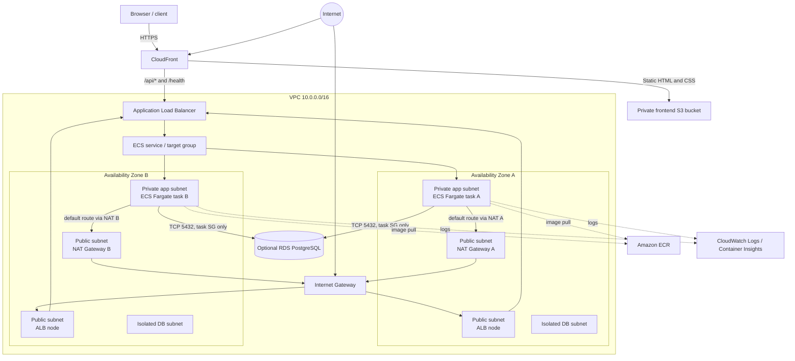

# Architecture Overview

## Project overview

This project deploys a static frontend and FastAPI service to AWS. CloudFront
serves the frontend from a private S3 bucket and routes API requests to an
internet-facing Application Load Balancer. The ALB forwards requests to an
ECS Fargate service running at least two tasks in private application subnets.
Each private subnet routes outbound traffic through a same-AZ NAT Gateway,
so tasks can pull images, write logs, and reach approved external services
without public IPs. An optional PostgreSQL RDS instance sits in isolated
database subnets; its security group accepts traffic only from the application
task security group. Terraform composes reusable network, service, and
database modules. GitHub Actions validates pull requests and uses OIDC with a
protected production environment to publish the frontend and immutable
application images, then apply reviewed Terraform plans.

For implementation details, see the guides for the
[application and frontend](./application.md),
[Terraform infrastructure](./terraform-infrastructure.md), and
[deployment workflows](./deployment-workflows.md).

## High-level diagram

ECR and CloudWatch are AWS regional services. The baseline uses NAT for task
egress. A production cost/security optimization could add ECR API, ECR Docker,
CloudWatch Logs, and S3 gateway VPC endpoints, then evaluate whether NAT is
still needed for other outbound dependencies.

## Subnet and route-table model

The network module derives `/24` subnets from `10.0.0.0/16`; by default it
creates two AZs. Each subnet type has a distinct route table:

| Tier | Example CIDRs (AZ A / AZ B) | Default route | Why |
| --- | --- | --- | --- |
| Public | `10.0.1.0/24`, `10.0.2.0/24` | `0.0.0.0/0 → IGW` | ALB nodes and NAT Gateways need internet reachability |
| Application private | `10.0.10.0/24`, `10.0.11.0/24` | `0.0.0.0/0 → same-AZ NAT Gateway` | Tasks have no public IP, but can initiate approved outbound connections |
| Database isolated | `10.0.20.0/24`, `10.0.21.0/24` | No internet default route | RDS is reachable inside the VPC, not directly from the internet |

Every subnet also has the implicit VPC-local route for `10.0.0.0/16`. The DB
subnet group spans multiple AZs even though the optional example DB is a
single-AZ instance by default. Use `multi_az = true` in the database module for
a higher-availability deployment, and discuss its cost and failover behavior.

The public subnets use one route table because their internet route is the same.
Each application subnet has its own route table so AZ A uses NAT A and AZ B
uses NAT B. A shared NAT is cheaper but introduces cross-AZ traffic and makes
private egress depend on a single AZ. NAT Gateways are stateful for outbound
connections; they do not make a private task publicly addressable.

## Request path

1. When a custom domain is configured, Route 53 resolves the hostname to
   CloudFront. Without a domain, clients use the ALB DNS endpoint directly.
2. CloudFront serves static files from the private S3 bucket and routes
   `/api/*` and `/health` requests to the ALB. CloudFront redirects viewer
   HTTP requests to HTTPS.
3. With CloudFront enabled, the ALB accepts HTTPS origin traffic from
   CloudFront's origin-facing prefix list. Without CloudFront, the ALB exposes
   the study service over HTTP.
4. The ALB forwards requests to an IP target group on port 8000 and health
   checks `/health`.
5. The task security group allows port 8000 only from the ALB security group.
   Tasks run in private subnets with `assign_public_ip = false`.
6. The ECS service spans both private subnets. ECS replaces unhealthy tasks;
   the deployment circuit breaker rolls back a failed deployment. CPU target
   tracking scales the service, with two tasks minimum.

## Identities: keep the roles distinct

- **GitHub Actions roles:** separate deployment and read-only plan roles are
  assumed through GitHub OIDC. The production environment protects deploy
  operations; no static AWS keys are used.
- **ECS task execution role:** assumed by the ECS agent to pull from ECR and
  publish container logs. It has the AWS-managed
  `AmazonECSTaskExecutionRolePolicy`.
- **ECS task role:** assumed by the application code. It is separate and
  currently has no permissions. Add only the AWS API permissions the app
  actually needs; do not give application code the execution role.
- **RDS master secret:** RDS generates and manages the master password in
  Secrets Manager. The example exposes the secret ARN but does not grant the
  app access or wire database environment variables because the hello-world
  app does not use PostgreSQL.

## Infrastructure and delivery guides

Terraform roots, modules, remote state, and bootstrap procedures are documented
in the [Terraform infrastructure guide](./terraform-infrastructure.md).
Pull-request checks, path-aware deployment sequencing, OIDC setup, and
production approvals are documented in the
[deployment workflows guide](./deployment-workflows.md). The FastAPI and
frontend implementation is covered by the [application guide](./application.md).

For end-to-end confidence, add Terratest (or equivalent) in an isolated AWS
test account: deploy a temporary stack, assert subnet routes/security-group
boundaries and the `/health` response through the ALB, then destroy it in a
cleanup step. Keep this separate from fast PR validation because provisioning
NAT Gateways and RDS is slower and incurs cost.

## Operational and security discussion

- **Availability:** tasks and ALB span AZs, desired count is at least two, and
  per-AZ NAT avoids a single egress-AZ dependency. The starter's RDS is
  single-AZ unless explicitly changed.
- **Ingress security:** CloudFront serves the frontend from a private S3
  origin with OAC, forwards API and health paths to the ALB, and adds managed
  security response headers. The ALB accepts origin traffic only from
  CloudFront's origin-facing prefix list. ALB access logs are encrypted and
  retained for 90 days; a production service should add WAF and rate limits.
- **Scaling:** CPU target tracking adjusts ECS desired count. In a real service,
  scale on request count/latency and queue depth where they better represent
  demand, and configure ALB target response alarms.
- **Observability:** Container Insights and CloudWatch logs are enabled. Add
  ALB metrics/access logs, alarms, traces, SLOs, and a Datadog/OpenTelemetry
  integration to match the team's observability platform.
- **Egress and cost:** per-AZ NAT is resilient but has fixed hourly and
  data-processing cost. VPC endpoints may lower data charges and reduce
  internet egress. Compare cost and required destinations before choosing.
- **Database:** use TLS to PostgreSQL, application-level least-privilege DB
  credentials, rotation, backups/PITR, restore tests, and Multi-AZ when
  required. Do not expose a DB port to `0.0.0.0/0`.
- **Secrets:** avoid plaintext secrets in Terraform variables/state or task
  definitions. Grant the task execution role access only to the exact secret
  ARNs needed by the app, then inject through ECS `secrets`.
- **Supply chain:** commit lock files, scan images, use immutable tags, pin
  third-party Actions to full commit SHAs in a production pipeline, and
  consider image signing and provenance attestations.
- **TLS/WAF/DNS:** custom DNS and HTTPS through CloudFront and ACM are
  optional. Without a configured domain, the study deployment exposes the ALB
  over HTTP. A public SaaS service should use HTTPS-only access and consider
  AWS WAF/rate limits.
- **Permissions:** the sample deployment policy is intentionally explicit but
  still broad for infrastructure creation. Validate it with IAM Access
  Analyzer and scope it to the deployment account/resources before production.

## Architecture decisions and tradeoffs

**ECS/Fargate rather than EKS:** For one HTTP service, Fargate avoids
operating worker nodes and Kubernetes control-plane abstractions. ECS is
integrated with AWS load balancing, IAM, and service deployment. EKS makes
sense when Kubernetes APIs/ecosystem, portability, or an existing platform
standard justifies the operational surface.

**Public ALB and private tasks:** The ALB is
the intentional public ingress boundary. Tasks need no public IP and accept
only load-balancer traffic, reducing attack surface.

**NAT Gateway availability:** With one NAT per AZ, egress for tasks in the
other AZ continues. Tasks in the affected AZ may lose outbound access until
recovery; ALB ingress may still work for already-running tasks. Alarms and
service placement/recovery policies should be considered.

**Reducing NAT dependency and cost:** NAT can be removed only if all required outbound dependencies are reachable
through VPC endpoints or other controlled paths. ECR pulls require ECR API and
Docker endpoints plus S3 access; logs need a CloudWatch Logs endpoint. External
APIs still need another egress design.

**Deployment availability:** Run at least two tasks across AZs,
configure ALB health checks, keep minimum healthy capacity at 100%, allow ECS
to start replacements before stopping old tasks, and use the circuit breaker.
Validate the app's startup/readiness behavior and database migration strategy.

**Additional controls for regulated workloads:** Separate AWS
accounts/environments, private endpoints where appropriate, stronger
least-privilege roles, TLS everywhere, WAF, encryption/key policy review,
central audit logging, backup/restore tests, policy checks, artifact
attestation, gated production applies, and compliance evidence.

## Deliberate limits of this study app

The frontend is a small static hello-world page, while FastAPI exposes only
the `/api/hello` and `/health` backend routes. The optional RDS is provisioned
privately but the app does not connect to it. WAF/rate limits and Datadog are
not included; these are explicit discussion points, not hidden claims of
production readiness.
